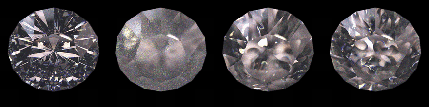
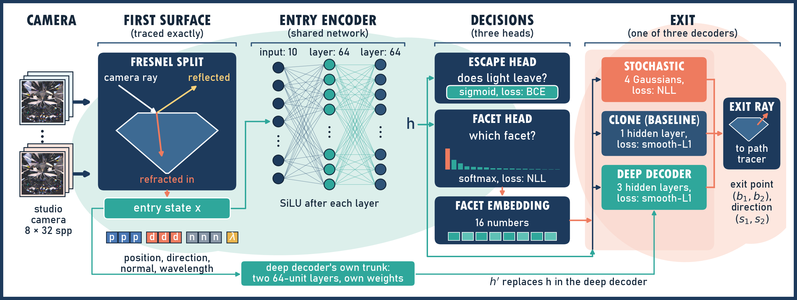
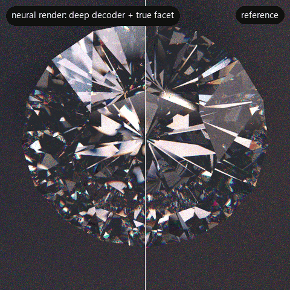
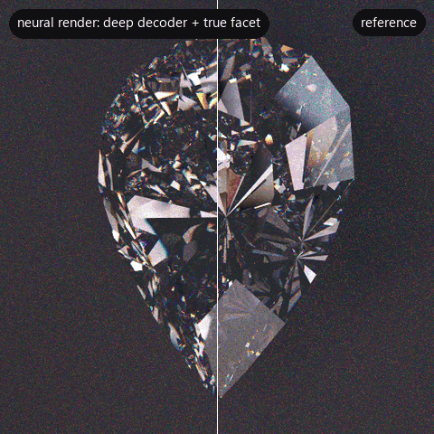
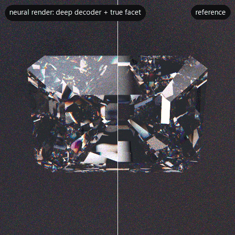

<div align="center">
  
  # An Exploration of Neural Transport Operators for Diamond Rendering

**Gopolang Mohlakola, Branden Ingram, and Pravesh Ranchod**<br>
University of the Witwatersrand, 2026

[**Project page**](https://sally-mohlakola.github.io/Neural_Diamond/)



<sub><b>exact tracer</b> &nbsp;·&nbsp; <b>stochastic</b> &nbsp;·&nbsp; <b>clone (baseline)</b> &nbsp;·&nbsp; <b>deep decoder</b></sub>

</div>

<br>

Can a small neural network replace the light transport inside a diamond? And if it cannot, which of its errors explain why the image differs?

<br>

The surface of the diamond is traced exactly. Inside, a network takes where and how light entered, and decides whether it escapes and through which facet. One of three decoders then places the exit.

<br>

## Architecture Overview



<br>

## True Facet Diamond Rendering

<div align="center">





<sub><b>GIA brilliant</b> &nbsp;·&nbsp; <b>pear</b> &nbsp;·&nbsp; <b>step cut</b></sub>

</div>

<br>

## Setup

Tested on Ubuntu 22.04 with Mitsuba 3.8.0 and PyTorch 2.12.1. Mitsuba's LLVM backend is not available on native Windows, so use Linux or WSL.

```bash
conda env create -f environment.yml
conda activate jojo
```

To check the installation, run the unit tests.

```bash
python -B -m unittest discover -s tests
```

<br>

## Usage

**1. Gather light paths through the diamond.** Make one pool for training and one for testing.

```bash
python -B pipeline/gather_learned_interior.py --output checkpoints/pools/gia/train.npz \
  --diamond_name round_diamond_gia --entries 32768 --paths_per_entry 16 --max_depth 128 --seed 1011 \
  --workers 16 --entry_sampling camera --azimuth_range 0 360

python -B pipeline/gather_learned_interior.py --output checkpoints/pools/gia/test.npz \
  --diamond_name round_diamond_gia --entries 8192 --paths_per_entry 16 --max_depth 128 --seed 1021 \
  --workers 16 --entry_sampling camera --azimuth_range 0 360
```

<br>

**2. Train, render, and score a decoder.** Choose the decoder with `--head`, which is `mixture`, `clone`, or `clone_deep`.

```bash
python -B pipeline/run_experiment.py --name gia_stochastic_s23 --head mixture --seed 23 \
  --pool checkpoints/pools/gia/train.npz --test_pool checkpoints/pools/gia/test.npz \
  --spp 32 --seeds 101 102 103 104 105 106 107 108
```

Models go to `checkpoints/`, renders to `renders/`, and run records to `figures/`. These folders are not in the repository.

<br>

## More

- [`docs/REPRODUCING.md`](docs/REPRODUCING.md) lists the commands behind every experiment and figure.
- [`legacy_rdm/`](legacy_rdm/README.md) holds the original radiance distribution map (RDM) code.

<br>

## Citation

```bibtex
@techreport{mohlakola2026neural,
  author      = {Gopolang Mohlakola and Branden Ingram and Pravesh Ranchod},
  title       = {An Exploration of Neural Transport Operators for Diamond Rendering},
  institution = {University of the Witwatersrand},
  type        = {Honours Research Report},
  year        = {2026}
}
```
